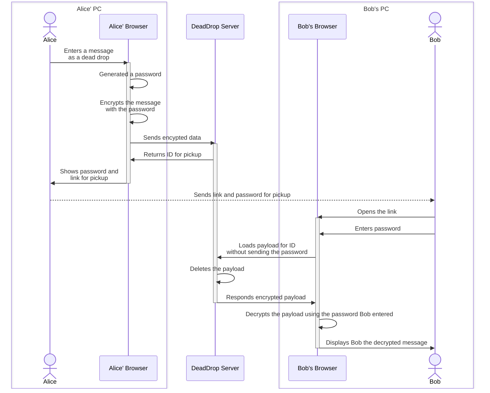
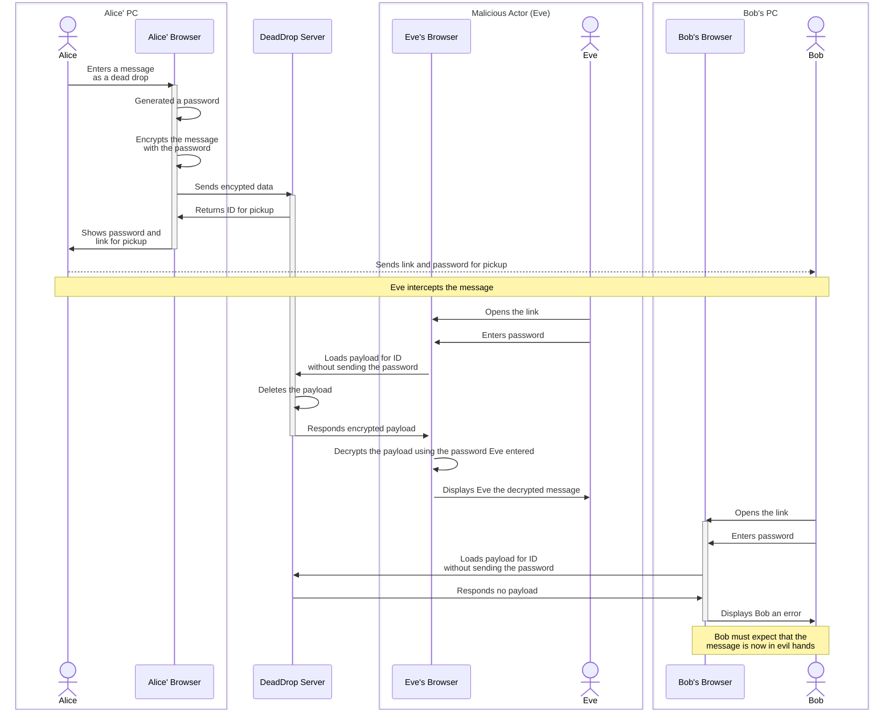
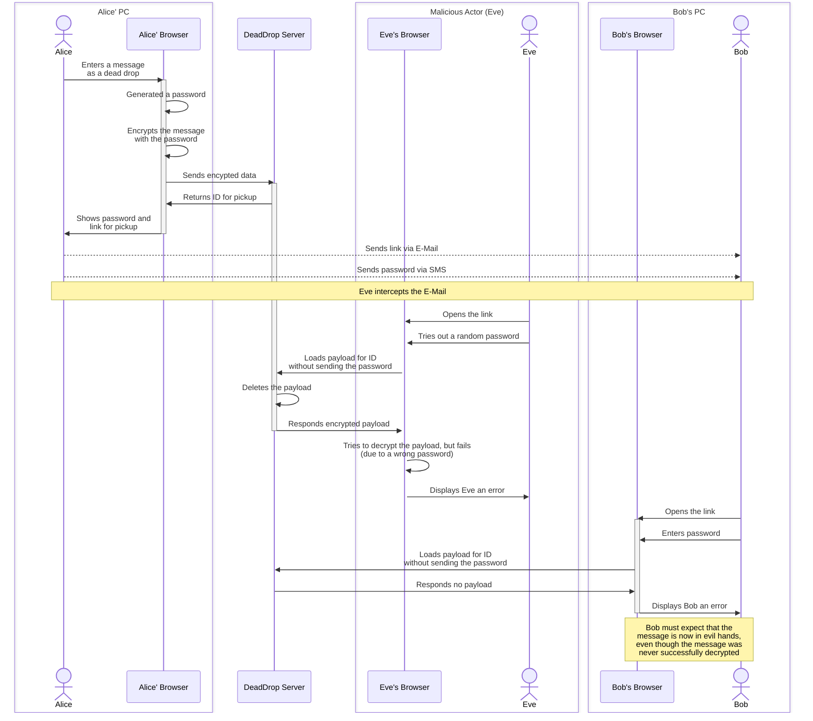
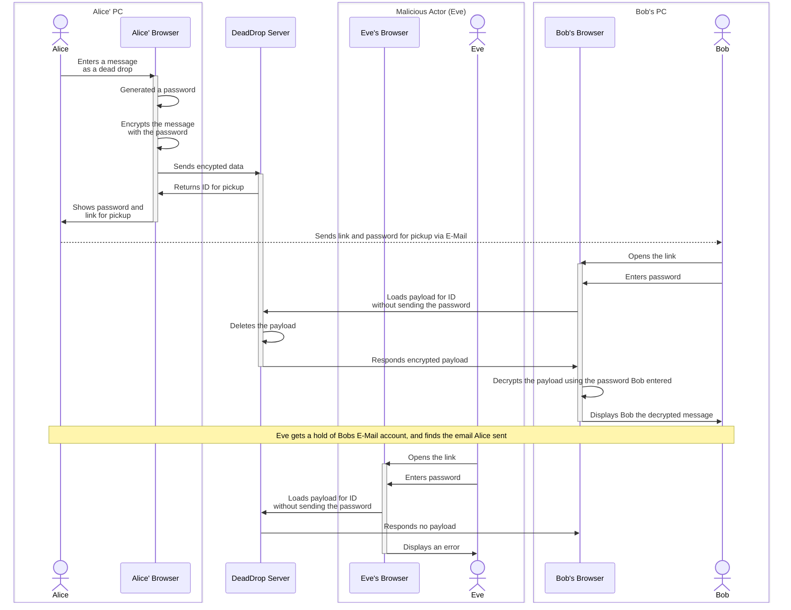

# Diagrams

A dead-drop is a service which stores encrypted messages, which can be retrieved exactly once.
If the message has been retrieved with a wrong password (and/or wrong person), the data is deleted (and cannot be
retrieved by the correct person / correct password anymore).

Therefore:

* when retrieving the data successfully, you know, only you got it.
* when the data could not be retrieved, you can expect someone else tried it already.

## Successful retrieval

This diagram shows the sequence of a successful exchange from Alice to Bob:

## Message (link and password) is intercepted

In this diagram, a malicious actor (`Eve`) got a hand of the message that Alice sent to bob, which contained both the
link and the password:

## Message (only link) is intercepted

In this example, the malicious actor (`Eve`) got a hold of one of the two messages which Alice sent to Bob, and will
with her attempt to guess the password destroy the drop. Bob can no longer retrieve the message (even though only he has
the correct password), and must expect that the message is lost (and possibly decrypted).

## Message is intercepted at a later point

This diagram shows what happens, if at a later point a malicious actor (`Eve`) gets a hold on the link and password
Alice sent to Bob (e.g. E-Mail account or messaging account got hacked at a later point).

While the message (and therefore link and password) are available to Eve, she can not do anything with this data (in
comparison to what would happen if Alice would have sent Bob the secret message directly).

